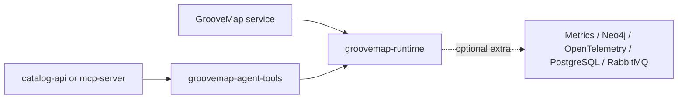

# GrooveMap Python libraries

MIT-licensed Python libraries shared by GrooveMap services. This repository is for engineers who
build or maintain a GrooveMap service, and for contributors to the libraries themselves. It owns
two independently buildable distributions with one synchronized version:

| Distribution | Import surface | Responsibility |
| --- | --- | --- |
| `groovemap-runtime` | `common` | Health server, logging, telemetry; normalization; retries and delivery; database and broker resilience; media, identity, event, and identifier helpers |
| `groovemap-agent-tools` | `common.agent_tools` | Framework-neutral catalog query tools used by the API and MCP server |

The runtime's base install is dependency-light. An extra is an optional dependency group, such
as `groovemap-runtime[postgres]`. Consumers select the `metrics`, `neo4j`, `otel`, `otel-http`,
`postgres`, or `rabbitmq` extra they need. `all` is intended for development and validation.
Service-specific behavior, OAuth, deployment policy, credentials, and extraction state remain
the responsibility of each consuming application.



The supported interpreter line is Python 3.14, pinned to Python 3.14.7 in CI. Neither
distribution installs a console command. See the local package contracts for the complete
[runtime API](docs/runtime.md), [agent-tools API](docs/agent-tools.md), and
[compatibility and release policy](docs/compatibility-and-releases.md).

## Use the libraries in a service

Nothing is published to a package registry yet. Consumers depend on an immutable commit of this
repository, plus the exact version, in their `pyproject.toml`:

```toml
[project]
dependencies = [
    "groovemap-agent-tools==<version>",
    "groovemap-runtime[otel,postgres]==<version>",
]

[tool.uv.sources]
groovemap-runtime = { git = "https://github.com/groovemap-music/python-libraries.git", rev = "<commit-sha>" }
groovemap-agent-tools = { git = "https://github.com/groovemap-music/python-libraries.git", subdirectory = "agent-tools", rev = "<commit-sha>" }
```

Replace `<version>` with the version in this repository's `pyproject.toml` and `<commit-sha>`
with the full commit hash to pin. Run `uv lock` to record the resolved commit, then import from
`common`:

```python
from common import setup_logging

setup_logging("my-service")
```

No credentials are needed. Read [the compatibility policy](docs/compatibility-and-releases.md)
before raising a pin.

## Valkey connection settings

`common.config.get_valkey_url()` (alias `_build_valkey_url()`) reads `VALKEY_HOST`
(default `localhost`), `VALKEY_PORT` (default `6379`), `VALKEY_PASSWORD`,
`VALKEY_PASSWORD_FILE` and `VALKEY_DB` (default `0`, range `0..255`). It returns
`valkey://` URLs, quotes passwords, and omits the authentication segment when no password is
set. A nonempty password file path wins over the plain password; an unreadable file raises
an error.

TLS is off by default. `VALKEY_TLS=true` makes the URL `valkeys://` with `ssl_cert_reqs=required`
and `ssl_check_hostname=true` query parameters, which valkey-py's `from_url` honors, so
`from_url(get_valkey_url())` callers need no code change. `VALKEY_TLS_CA_FILE` adds a private CA
(unset trusts the system CAs), `VALKEY_TLS_CERT_FILE` and `VALKEY_TLS_KEY_FILE` supply a client
certificate (set both or neither), and `VALKEY_TLS_VERIFY_HOSTNAME=false` is the only way to turn
hostname checking off. Both flags accept only true/false tokens (typos raise). Configured files must exist or `ValueError` is raised.

`VALKEY_KEY_PREFIX` (default `groovemap:`; empty disables) namespaces keys on a shared
instance. Build keys with `common.valkey_key(*parts)` and SCAN/KEYS globs with
`common.valkey_pattern(pattern)`. See [the runtime contract](docs/runtime.md) for the
default-prefix decision and the rollout note for existing deployments.

Only `VALKEY_*` variables are read.

## Development

Install [mise](https://mise.jdx.dev/) and run:

```bash
mise install
just setup
just check
```

The supported recipe surface is grouped by purpose below. `just coverage` is the CI-facing alias
for the same test-and-coverage capability as `just test`; it does not maintain a second command
body.

| Purpose | Recipes |
| --- | --- |
| Discover and provision | `just` / `just default` lists recipes; `just setup` installs the locked workspace and all supported extras |
| Repair and local feedback | `just format` applies formatting and safe lint fixes; `just test-integration` exercises the live RabbitMQ integration path |
| Complete pre-merge gate | `just check` runs `setup`, then composes `format-check`, `lint`, `typecheck`, `test`, `automation-check`, `consumer-matrix-check`, `publication-readiness-check`, `media-taxonomy-check`, `identity-vocabulary-check`, `event-vocabulary-check`, `identifier-vocabulary-check`, `company-role-vocabulary-check`, `build`, `distribution-check`, `install-check`, `license-check`, `secret-scan`, and `bump-preview` |
| CI capability aliases | `just coverage` delegates to `test`; the other individual check dependencies are supported for focused CI or developer diagnosis |
| Network and release rehearsal | `just audit` queries vulnerability data; `just release-dry-run` adds checksums, an SBOM, notices, and provenance after `check`; `just publication-readiness` adds `audit` and the final attestation |
| Approved version maintenance | `just bump` updates local version metadata, changelog, and lock data only |

Network access and publishing stay outside `just check`. `audit` needs current vulnerability
data, while `bump`, `release-dry-run`, and `publication-readiness` remain local-only; none publishes,
tags, pushes, or changes repository visibility.

The default `just test` and `just check` paths exclude tests marked `integration` and never
contact a broker. `just test-integration` runs `tests/test_rabbitmq_integration.py`; without
`RABBITMQ_HOST` it reports those live-broker tests as skipped. To run them locally, provide a
reachable RabbitMQ 4 management broker and set these variables:

| Variable | Meaning | Default |
| --- | --- | --- |
| `RABBITMQ_HOST` | Broker host; the tests are skipped while it is unset | unset |
| `RABBITMQ_USERNAME` | Broker user | `groovemap` |
| `RABBITMQ_PASSWORD` | Broker password | `groovemap` |
| `RABBITMQ_AMQP_PORT` | AMQP port | `5672` |
| `RABBITMQ_MGMT_PORT` | Management API port | `15672` |

CI provisions a digest-pinned RabbitMQ 4 management container, waits for broker readiness,
and passes `just test-integration` through the reusable workflow's integration command. That
command is part of the single `required` job, so a heartbeat-negotiation or reconnect failure
blocks both ordinary and Dependabot pull requests with no actor-specific reduced path.

Both distributions' wheels and source archives are written directly to `dist/`. To prove that
the wheels work independently, run `just install-check`, which creates isolated temporary
environments and imports both packages from their built wheels. `just release-dry-run` also
generates SHA-256 checksums, a CycloneDX SBOM, third-party notices, and commit-bound local
provenance without publishing, tagging, or pushing anything.

From a clean reviewed commit, `just publication-readiness` runs the complete validation, audit,
and release rehearsal and writes an ignored, deterministic attestation to `dist/`. The
[publication-readiness guide](docs/publication-readiness.md) lists the visibility, anonymous-fetch,
credential-removal, and package-release approvals that remain external to repository validation.

## Vendored design vocabularies

The `design` repository is the source of truth for five shared vocabularies. This repository
vendors them: it ships a verbatim, byte-for-byte copy as package data inside the
`groovemap-runtime` wheel, and never edits that copy. A `source.json` beside each copy records
the `design` commit and the SHA-256 digest of every vendored file. Where a vocabulary has
conformance fixtures, the fixtures at the same commit are vendored into `tests/fixtures/` with
their own `source.json`.

| Vocabulary | Governing ADR | Upstream directory in `design` | Vendored copy | Fixtures | Check script |
| --- | --- | --- | --- | --- | --- |
| Media taxonomy | [ADR 0007](https://github.com/groovemap-music/design/blob/main/docs/adr/0007-canonical-media-taxonomy.md) | `taxonomy/media/v1/` (`media-taxonomy.json`) | `src/common/media_taxonomy/` | `tests/fixtures/media/` (not digest-checked) | `scripts/check-media-taxonomy.py` |
| Identity vocabulary | [ADR 0009](https://github.com/groovemap-music/design/blob/main/docs/adr/0009-native-identity-and-provider-aliases.md) | `taxonomy/identity/v1/` (`identity-vocabulary.json`) | `src/common/identity_vocabulary/` | none | `scripts/check-identity-vocabulary.py` |
| Event vocabulary | [ADR 0010](https://github.com/groovemap-music/design/blob/main/docs/adr/0010-first-party-events-consent-and-deletion.md) | `taxonomy/events/v1/` (`event-types.json`, `event-envelope.schema.json`, `impression.schema.json`) | `src/common/event_vocabulary/` | `tests/fixtures/events/` | `scripts/check-event-vocabulary.py` |
| Identifier vocabulary | [ADR 0011](https://github.com/groovemap-music/design/blob/main/docs/adr/0011-catalog-identifiers-and-manufacturing-credits.md) | `taxonomy/identifiers/v1/` (`identifier-types.json`, `identifier-types.schema.json`, `identifier-block.schema.json`) | `src/common/identifier_vocabulary/` | `tests/fixtures/identifiers/` | `scripts/check-identifier-vocabulary.py` |
| Company-role vocabulary | ADR 0011 | `taxonomy/company-roles/v1/` (`company-roles.json`, `company-roles.schema.json`, `company-block.schema.json`) | `src/common/company_role_vocabulary/` | `tests/fixtures/company-roles/` | `scripts/check-company-role-vocabulary.py` |

`just check` runs every check script. Each recomputes the recorded digests and fails if one
differs or a file is missing. A failure means a vendored copy is stale.

To re-vendor after an upstream change:

1. Copy every changed file from the reviewed `design` commit.
2. Recompute each digest, for example
   `shasum -a 256 src/common/media_taxonomy/media-taxonomy.json`.
3. Update the `commit` and `sha256` fields in the matching `source.json`. The media taxonomy
   has one top-level `sha256`; the other vocabularies list a `sha256` per entry under `files`.
4. Run `just check`.

The media taxonomy is also vendored the same way into `discogs-ingestion` and
`musicbrainz-ingestion`. Keep all three in step with the same reviewed `design` commit.

## License and history

The current tree is licensed under the [MIT License](LICENSE). Its relevant source history was
preserved during repository extraction. Historical license revisions remain available in Git;
the source repository was not rewritten. The local [extraction record](docs/extraction.md)
contains the provenance details.

## Documentation

See the [documentation index](docs/README.md) for package contracts, compatibility, releases,
migration authentication, consumer compatibility evidence, and source-history provenance.
